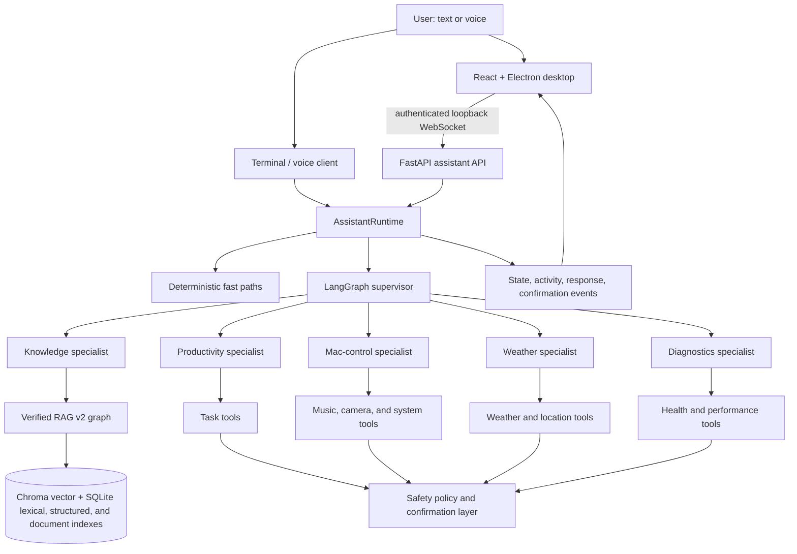
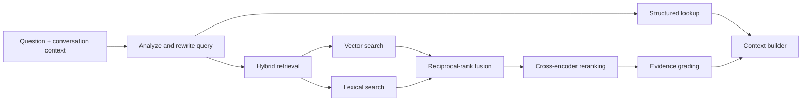

# DARWIN

**Distributed Agentic Reasoning and Workflow Intelligence Network**

DARWIN is a local-first, voice-enabled personal operations assistant for macOS. It combines a desktop environment, natural-language interaction, specialist agents, guarded system tools, persistent conversations, and an evidence-verified retrieval-augmented generation (RAG) system.

Rather than behaving like a single chatbot with unrestricted access to every capability, DARWIN uses a supervisor to understand each request and delegate it to the smallest appropriate specialist. Those specialists can search private knowledge, inspect tasks, fetch live weather, control supported Mac features and media, operate the camera, or report diagnostics. Actions pass through an allowlisted safety layer, while knowledge answers pass through retrieval, evidence grading, citation generation, and verification before they are returned.

> DARWIN is under active development. It currently targets macOS and Python 3.11, and some integrations require local services, credentials, models, or operating-system permissions.

## What DARWIN does

- Accepts text, push-to-talk voice, or continuous wake-word conversation.
- Routes requests to knowledge, productivity, Mac-control, weather, and diagnostics specialists.
- Searches local documents with verified, citation-aware RAG.
- Controls allowlisted system features such as volume, display brightness, keyboard brightness, music, and camera functions.
- Integrates with native macOS data and services, including reminders and calendars.
- Supports Spotify and Apple Music playback workflows.
- Provides speech-to-text, text-to-speech, speaker identity, wake-word detection, and audio-focus management.
- Persists conversational state by session and exposes structured runtime events to the desktop UI.
- Records optional local performance telemetry and optional LangSmith traces for RAG debugging and evaluation.

## Architecture

DARWIN uses a layered, event-driven architecture. The React renderer is isolated from the assistant implementation by Electron and a versioned local protocol. The Python runtime owns orchestration, agents, tools, safety, voice, and RAG.



### Main layers

| Layer | Responsibility | Main location |
| --- | --- | --- |
| Desktop | React interface, OS-like workspace, Electron lifecycle, IPC, and native bridges | `darwin-ui/` |
| Local API | Authenticated loopback HTTP/WebSocket boundary and protocol validation | `src/app/services/assistant_api.py` |
| Runtime | Session lifecycle, request serialization, cancellation, confirmation, events, and fast paths | `src/app/runtime.py` |
| Orchestration | Intent routing, specialist delegation, and final response synthesis | `src/app/agents/` |
| Tools and integrations | Tasks, weather, camera, music, system controls, and diagnostics | `src/app/tools/`, `src/app/integrations/` |
| Safety | Allowlisted policies, risk levels, guarded execution, confirmation, and audit behavior | `src/app/safety/` |
| Knowledge | Parsing, indexing, retrieval, grounding, citations, verification, and evaluation | `src/app/ragv2/` |
| Voice | Wake word, microphone capture, speech activity, transcription, speaker identity, and speech output | `src/app/voice/` |
| OS adapters | Platform capability discovery and macOS/Linux/Windows adapter boundaries | `src/app/system/` |

The primary hosted reasoning model is Groq's `openai/gpt-oss-120b`. DARWIN falls back to a local Ollama `qwen3:14b` model when the primary provider is unavailable. Smaller judge models are used for bounded RAG decisions and answer verification.

## How the multi-agent system works

DARWIN follows a **supervisor-and-specialists** pattern built with LangGraph:

1. `AssistantRuntime` receives a request and associates it with a session and request ID.
2. Deterministic fast paths handle selected latency-sensitive intents, such as conversational weather corrections and explicit camera commands.
3. The supervisor interprets the remaining request and either answers directly or calls a specialist as a tool.
4. The chosen specialist uses only the tools assigned to its domain.
5. Tool calls run through DARWIN's safety policy. Unknown actions fail closed; actions with elevated risk can require confirmation.
6. The specialist returns private evidence to the supervisor, which produces one concise, speech-friendly final response.
7. Runtime events report thinking state, specialist activity, partial/final responses, errors, and confirmation requests to the client.

The current specialists are:

- **Knowledge** — sends project, private-document, and source-backed questions directly to verified RAG v2.
- **Productivity** — reads task data through the task tools.
- **Mac control** — operates allowlisted music, camera, volume, and display/keyboard brightness tools.
- **Weather** — resolves location and retrieves current conditions instead of inventing live data.
- **Diagnostics** — reports measured health, latency, reliability, and performance information.

Specialists are invoked sequentially. The supervisor is explicitly configured to call at most one specialist at a time and then produce a single response. Individual subsystems may still use bounded internal concurrency—for example, RAG runs vector and lexical searches in parallel—but agents do not independently converse or modify shared plans.

Conversation state is checkpointed in SQLite (`data/conversation_memory.sqlite`) by session ID. This lets the LangGraph supervisor retain message history across turns. The desktop API also maintains one serialized `AssistantRuntime` per OS session, preventing overlapping requests from corrupting a session's conversational state.

## How RAG works

The current knowledge path uses `ragv2`, an explicit corrective RAG graph designed to prefer supported answers over plausible guesses.

### 1. Ingestion

```text
Source -> parse -> normalize -> content-aware chunk -> index
```

The parser router accepts text, Markdown, source code, images, public web pages, and office/document formats including PDF, DOCX, PPTX, and XLSX. Documents are normalized into a common structure containing sections, tables, images, headings, page numbers, source metadata, and stable identifiers.

Separate chunkers handle prose, tables, images, and code. The resulting chunks are written to four local representations:

- **Chroma vector index** for semantic similarity, using Ollama's `nomic-embed-text` embeddings.
- **SQLite lexical index** for exact terms and keyword-oriented retrieval.
- **SQLite structured index** for queries that can be answered directly from tabular data.
- **SQLite document store** for normalized source documents and metadata.

Re-ingesting the same stable document ID replaces its previous vector, lexical, and structured records rather than silently duplicating them. Optional assisted parsing can use LlamaParse when `DARWIN_ENABLE_ASSISTED_PARSING=true` and `LLAMA_CLOUD_API_KEY` is configured.

### 2. Query planning and retrieval



The query analyzer turns follow-ups into standalone questions and can choose direct retrieval, conversation-aware retrieval, decomposition for multi-part questions, or step-back retrieval. Structured lookup is attempted where applicable. Semantic and lexical search run concurrently, and reciprocal-rank fusion combines their rankings. A cross-encoder then reranks candidates, evidence is graded for relevance and directness, and the context builder selects parent-aware evidence within a token budget.

If a decomposed question has multiple information needs, retrieval can search those needs concurrently while preserving which parts remain unanswered.

### 3. Corrective generation and verification

```text
retrieve
  |-- sufficient evidence --> generate --> verify --> finalize
  |-- partial evidence ----> rewrite --> retrieve correction --+
  |-- web allowed/needed --> search web ------------------------+
  `-- no reliable evidence ------------------------------------> abstain

verification failure --> regenerate once --> verify/finalize or abstain
```

The LangGraph workflow records an evidence status of sufficient, partial, or irrelevant and follows a bounded route:

- Sufficient evidence goes to grounded answer generation.
- Partial evidence triggers one corrective query rewrite and retrieval attempt by default.
- Optional web retrieval is used only when the caller explicitly enables it.
- Generated claims are checked by an independent verifier against the assembled context.
- Failed verification can trigger one evidence-guided regeneration.
- If the bounded process still cannot support the answer, DARWIN abstains instead of fabricating a result.

Grounded answers carry document, source, heading, and page metadata where available. The knowledge specialist returns the verified answer to the supervisor without adding a second agentic model hop, reducing latency and limiting opportunities to distort citations.

RAG configuration lives in `src/app/ragv2/config.py`; evaluation and benchmark utilities live in `src/app/ragv2/eval/`.

## Repository structure

```text
DARWIN/
├── main.py                         # Terminal and voice entry point
├── pyproject.toml                  # Python package and dependencies
├── src/app/
│   ├── agents/                     # Supervisor and specialist agents
│   ├── integrations/               # Music and external integrations
│   ├── llm/                        # Models, fallback, telemetry, usage
│   ├── protocol/                   # Versioned client/server schemas
│   ├── ragv2/                      # Ingestion, retrieval, graph, generation, eval
│   ├── safety/                     # Policies, confirmations, guarded executor
│   ├── services/                   # Local API and application services
│   ├── system/                     # OS capability adapters
│   ├── tools/                      # Agent-callable tools
│   └── voice/                      # Speech and wake-word pipeline
├── darwin-ui/
│   ├── electron/                   # Backend lifecycle, IPC, and native services
│   ├── native/                     # Swift macOS bridges
│   ├── shared/                     # Typed protocol contracts
│   └── src/                        # React desktop renderer
├── tests/                          # Backend and RAG test suites
├── scripts/                        # Reproducible development setup utilities
├── third_party/                    # Pinned external manifests and DARWIN patches
├── docs/                           # Protocol, voice, shortcuts, and baseline docs
└── data/                           # Local runtime data, indexes, logs, and models
```

## Requirements

- macOS for the complete desktop and native-integration experience.
- Python 3.11.x. The metadata permits newer versions, but they are not considered supported until the full suite passes.
- Node.js 22.12 or newer and npm for the desktop UI.
- [Ollama](https://ollama.com/) with the required local models for embeddings and fallback reasoning.
- A Groq API key for the primary hosted model.
- Microphone permission and host audio libraries for voice features.

## Setup

The development environment used by this project is a Conda environment named `DARWIN`:

```bash
conda activate DARWIN
python --version
python -m pip install -e ".[dev,vision]"
```

Pull the default local models:

```bash
ollama pull qwen3:14b
ollama pull qwen3:8b
ollama pull nomic-embed-text
```

### Optional training and benchmark workspaces

DARWIN uses four third-party projects for development workflows, but their
checkouts are not runtime dependencies and are intentionally excluded from the
main repository:

| Project | DARWIN usage | Required for normal runtime? |
| --- | --- | --- |
| `openWakeWord` | Trains the custom `Darwin` wake-word model | No; runtime uses the installed `openwakeword` package and exported ONNX model |
| `piper-sample-generator` | Generates synthetic positive audio for wake-word training | No |
| `CLAPNQ` | Supplies an optional long-form RAG benchmark dataset | No |
| `RAGChecker` | Supplies benchmark metadata and reference assets; the installed `ragchecker` package performs scoring | No |

Their upstream URLs, exact commit SHAs, destinations, and DARWIN patches are
versioned in `third_party/dependencies.json`. The patches preserve the
macOS/MPS, audio-resampling, recursive dataset discovery, ONNX export,
checkpoint, and TorchScript compatibility changes used for DARWIN's existing
wake-word training runs.

Restore only the workspace needed for a development task:

```bash
# Custom wake-word training
python scripts/setup_external_dependencies.py wakeword

# Industry RAG benchmark preparation
python scripts/setup_external_dependencies.py rag

# Restore every optional workspace
python scripts/setup_external_dependencies.py all
```

The setup script clones each project at its pinned detached commit and applies
the corresponding DARWIN patch. It refuses to overwrite an existing directory.
The restored directories remain ignored by DARWIN Git because they are external
working data, not vendored application source.

Wake-word training imports the restored openWakeWord checkout from
`training/wakeword/openWakeWord` and the Piper adapter imports
`training/wakeword/piper-sample-generator`. The trained model is exported into
the local model workspace and the runtime expects the configured ONNX model,
such as `data/models/openwakeword/darwin_media_v2.onnx`.

RAG benchmark preparation reads CLAPNQ from
`data/external/ragchecker/raw_data/clapnq` and RAGChecker metadata from
`data/external/ragchecker/vendor/RAGChecker`. Benchmark indexes, runs, and
reports are generated locally under `data/ragv2/industry_benchmarks/`.

Create a `.env` file in the repository root. The minimal model configuration is:

```dotenv
GROQ_API_KEY=your_groq_api_key
```

Optional integrations and behavior include:

```dotenv
# Spotify
SPOTIFY_CLIENT_ID=your_client_id
SPOTIFY_REDIRECT_URI=your_redirect_uri
SPOTIFY_DEVICE_NAME=optional_device_name

# Fish Audio text-to-speech
FISH_API_KEY=your_fish_api_key
FISH_VOICE_ID=your_voice_id
FISH_TTS_MODEL=s2.1-pro-free
FISH_TTS_TRANSPORT=http
FISH_TTS_LATENCY=balanced
FISH_TTS_CHUNK_LENGTH=100
FISH_TTS_MIN_CHUNK_LENGTH=30
FISH_TTS_NORMALIZE=true
DARWIN_SPEAK_PARTIAL_RESPONSES=false

# Speech-to-text latency tuning
DARWIN_WHISPER_MODEL=small.en
DARWIN_WHISPER_DEVICE=cpu
DARWIN_WHISPER_COMPUTE_TYPE=int8
DARWIN_WHISPER_BEAM_SIZE=1
DARWIN_WHISPER_VAD_FILTER=false
DARWIN_WHISPER_WARMUP=true
DARWIN_STT_ENDPOINT_PREFETCH=true
DARWIN_STT_PREFETCH_SILENCE_SECONDS=0.24

# Optional assisted document parsing
DARWIN_ENABLE_ASSISTED_PARSING=false
LLAMA_CLOUD_API_KEY=your_llama_cloud_key

# Optional local performance log
DARWIN_STATS_LOG_ENABLED=false
DARWIN_STATS_LOG_FILE=data/logs/darwin-performance.jsonl
```

The free Fish model currently uses HTTP streaming. Accounts with Fish API
credit can opt into the production WebSocket path with
`FISH_TTS_MODEL=s2-pro` and `FISH_TTS_TRANSPORT=websocket`. DARWIN falls back to
HTTP only when WebSocket setup fails before emitting audio.

Spoken turns add a `voice_latency` JSON Lines record containing
`recording_seconds`, `stt_seconds`, `reasoning_seconds`,
`tts_network_first_chunk_seconds`, `tts_first_audio_seconds`,
`response_latency_after_stt_seconds`,
`playback_seconds`, and `total_turn_seconds`. The response-latency value is the
user-perceived delay from completed transcription until DARWIN's first audible
TTS sample; the TTS first-audio value isolates speech generation/output startup.

The `vision` extra installs OpenCV and Ultralytics. The small YOLO model is downloaded to the ignored `data/models/` directory on first use.

## Run DARWIN

### Terminal or voice mode

```bash
conda activate DARWIN
python main.py
```

Choose `text`, `voice`, or `continuous` when prompted. Continuous mode uses the configured wake-word and follow-up conversation pipeline.

### Desktop UI

```bash
cd darwin-ui
npm install
npm run install:runtime
npm run dev
```

Electron starts the Python assistant backend itself, assigns an available loopback port, creates a per-launch authentication token, and connects through the versioned WebSocket protocol. `DARWIN_PYTHON` can be set when Electron should use a specific Python interpreter.

For API development without Electron:

```bash
DARWIN_API_TOKEN=development-only python -m app.services.assistant_api
```

The server binds to `127.0.0.1:8765` by default. `GET /health` exposes backend and protocol versions, while `/ws` carries authenticated, schema-validated assistant messages.

## Add knowledge to RAG

There is currently no dedicated ingestion CLI. Use `RagIngestor` from the installed package:

```bash
python - <<'PY'
from app.ragv2.ingest.ingest import RagIngestor

report = RagIngestor().ingest("docs/VOICE_AND_SPEECH.md")
print(report)
PY
```

Replace the source with a supported local file or a public `http`/`https` URL. Generated indexes are stored under `data/ragv2/indexes/` and are intentionally local runtime data.

To query RAG directly:

```bash
python - <<'PY'
from app.ragv2.service import RagService

response = RagService().ask("How does DARWIN handle continuous voice input?")
print(response.answer.answer)
for citation in response.answer.citations:
    print(citation)
PY
```

Web fallback is off by default. A direct caller must explicitly pass `allow_web_search=True` to permit it.

## Testing and quality checks

Run the Python suite:

```bash
conda activate DARWIN
python -m pytest -q
```

Run the desktop checks:

```bash
cd darwin-ui
npm run typecheck
npm run lint
npm run format:check
npm test
npm run build
```

## Observability and privacy

DARWIN is local-first, but not every configured provider is local. Groq, Fish Audio, Spotify, LlamaParse, public web retrieval, and LangSmith can transmit relevant request data when enabled. Ollama inference, SQLite state, Chroma indexes, logs, and ingested documents remain local unless another configured feature sends them elsewhere.

RAG LangSmith tracing is disabled unless explicitly enabled:

```dotenv
LANGSMITH_TRACING=true
LANGSMITH_API_KEY=your_langsmith_api_key
LANGSMITH_PROJECT=darwin-rag-v2
LANGCHAIN_CALLBACKS_BACKGROUND=true
```

Traces may include questions, prompts, retrieved content, model calls, evidence grades, answers, routes, and timings. Leave tracing off for data that must not leave the machine.

Local performance logging is also opt-in because each JSON Lines record can include the user's question. Runtime data, credentials, models, indexes, voice profiles, and logs are excluded from source control through `.gitignore`.

## Additional documentation

- [Voice and speech](docs/VOICE_AND_SPEECH.md)
- [UI protocol](docs/ui-protocol.md)
- [Keyboard shortcuts](docs/keyboard-shortcuts.md)
- [Backend baseline](docs/backend-baseline.md)
- [Project checklist](project-checklist.md)
